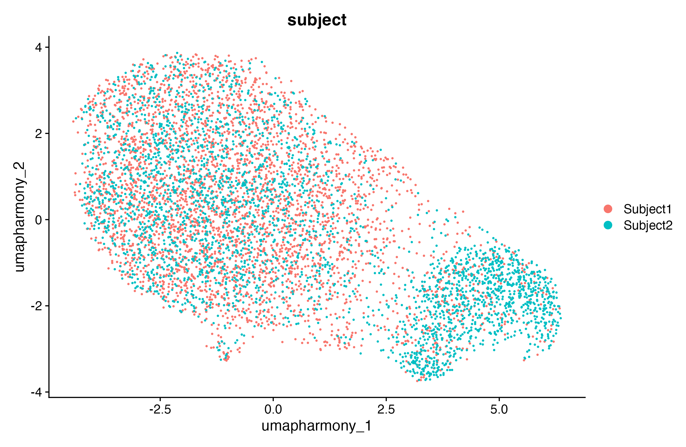
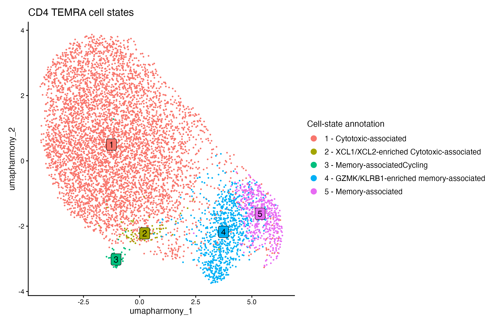
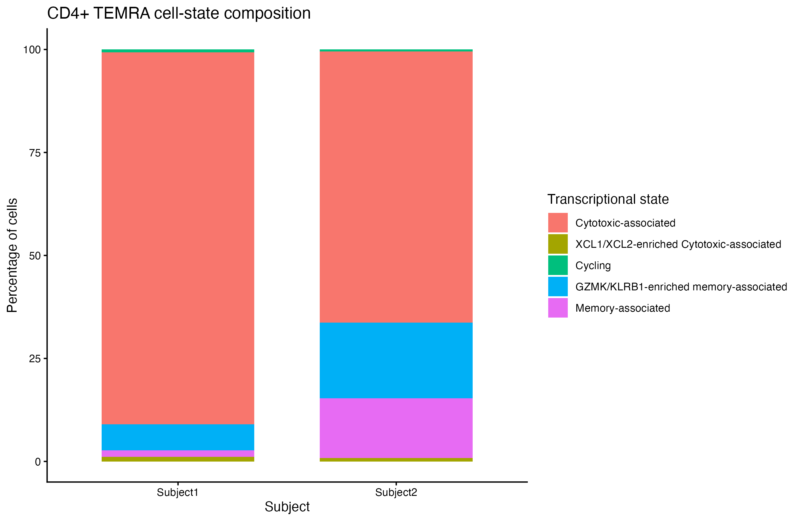

# Can memory T cells exhibit cytotoxic behaviour?
## YES, THEY CAN!*
###### *(Okay not all CD4+ T cells, but some specialized ones surely can! :P)

We usually associate cytotoxicity with CD8+ T cells or natural killer cells. CD4+ T cells, on the other hand, 
are generally known for coordinating immune responses. But some CD4+ memory T cells can develop cytotoxic characteristics too!

A paper by [Patil et al. (2018)](https://pmc.ncbi.nlm.nih.gov/articles/PMC5931334/#S2) investigated human CD4+ cytotoxic T lymphocytes and their potential precursors. 
The study identified considerable heterogeneity within a particular terminally differentiated effector memory T cell population re-expressing CD45RA or for short **TEMRA**,
including cells with cytotoxic effector programs and others with more memory-associated characteristics.

In order to look at these specialized T cells myself, I decided to explore the publicly available dataset.

## The dataset
I used the 10x Genomics single-cell RNA-seq dataset from the reference paper.

- **Dataset:** [GSE106543 - NCBI GEO](https://www.ncbi.nlm.nih.gov/geo/query/acc.cgi?acc=GSE106543)
- **Cell population:** Human CD4+ TEMRA cells
- **Samples:** Peripheral blood of 2 human donors
- **Starting dataset:** 6,984 cells

## Methodology
I performed the analysis in R, using Seurat for single-cell preprocessing, clustering and differential gene expression analysis, and Harmony for donor-associated integration.

1. **Quality control:** Examined gene counts, detected features and mitochondrial gene percentages to filter low-quality cells.
2. **Preprocessing:** Normalization, identification of highly variable genes, scaling and principal component analysis (PCA).
3. **Clustering:** Constructed a nearest-neighbor graph and identifying transcriptionally similar populations.
4. **Integration:** Reduced donor-associated variation in the dimensional representation.
5. **Marker analysis:** Identified genes enriched in different clusters and assigning broad transcriptional-state annotations.

## Findings
### 1. A diverse cytotoxic-associated population
Several clusters expressed genes associated with cytotoxic lymphocyte activity, including **GNLY**, **GZMB**, **PRF1**, **NKG7** and **FGFBP2**.
However, their expression was not uniform across all cells, suggesting heterogeneity even within the broadly cytotoxic-associated population.

### 2. Memory-associated cells are still present
Not every CD4+ TEMRA cell exhibited a strong cytotoxic transcriptional program.
Some cells expressed higher levels of **IL7R**, **LTB** and **GPR183**, consistent with a more memory-associated state.

### 3. A GZMK/KLRB1-enriched population
Another population was enriched for **GZMK** and **KLRB1**, alongside memory-associated genes. Suggesting additional heterogeneity within the memory-associated cluster.

### 4. A small chemokine-enriched population
One of the smaller clusters, containing just 67 cells, showed strong enrichment of **XCL1** and **XCL2**. These chemokines are associated with immune-cell communication, 
including interactions with dendritic cells. The cluster also expressed cytotoxic-associated genes, suggesting a potentially distinct chemokine-expressing state within the cytotoxic-associated population.

### 5. A cycling population
A small population expressed proliferation-associated genes such as **MKI67**, **TYMS**, **PCNA** and **MCM7**, consistent with cells undergoing cell-cycle activity.

### Integrated UMAP

  

### Broad transcriptional states

  

### Cell-state composition

  

## So, what's the takeaway?
**CD4+ memory T cells aren't limited to coordinating immune responses. Some can exhibit strong cytotoxic-associated transcriptional programs.**

Another interesting observation is that CD4+ TEMRA cells are not transcriptionally identical. Within the same broadly defined cell population, 
we can identify cells with cytotoxic-associated, memory-associated, chemokine-enriched and proliferative expression programs.

### Tools used
**R · Seurat · Harmony · ggplot2 · dplyr**

All analysis scripts and generated figures are available in this repository. 
The original dataset can be downloaded from GEO accession [GSE106543](https://www.ncbi.nlm.nih.gov/geo/query/acc.cgi?acc=GSE106543). 

### Reference
Patil VS, Madrigal A, Schmiedel BJ, Clarke J, O'Rourke P, de Silva AD, Harris E, Peters B, Seumois G, Weiskopf D, Sette A, Vijayanand P. 
Precursors of human CD4+ cytotoxic T lymphocytes identified by single-cell transcriptome analysis. Sci Immunol. 2018 Jan 19;3(19):eaan8664. 
doi: 10.1126/sciimmunol.aan8664. PMID: 29352091; PMCID: PMC5931334.

[Read the original paper](https://pmc.ncbi.nlm.nih.gov/articles/PMC5931334/#S2) | [Access the GEO dataset](https://www.ncbi.nlm.nih.gov/geo/query/acc.cgi?acc=GSE106543)

